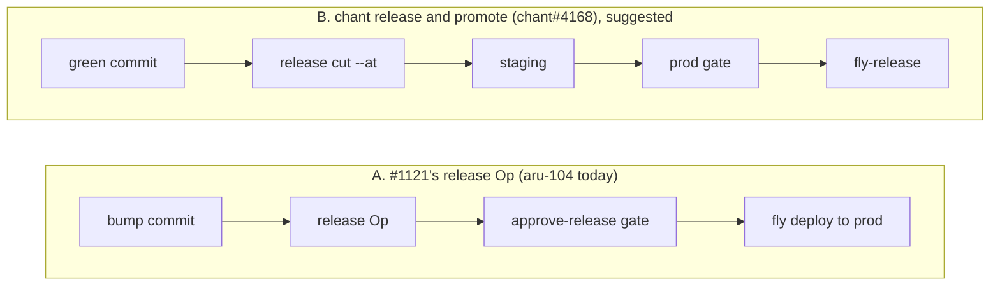

# Arugula and chant: where the line goes

22 Oct 2026 · Arugula at f5db1ee9 plus #1334, #1349, #1359 · chant 0.124.40

**Updated 28 Oct 2026** (Arugula 781b391d, chant 0.124.56 at b1b9e44a1). Since this was written, Arugula's own release moved to an `arugula-release` driver (#1372, M221) instead of either release path below. The chant contract asks were checked against chant's source and the gaps filed upstream, and the boundary gained a CI row. Marked inline as *(28 Oct)*.

The platform tab asks one question that matters most for chant: "For plans and reviews, which is the source of truth, chant records in the repo or platform objects?" Its recommendation is platform objects for the work, chant records for decisions and releases, linked both ways. I agree with that, and this note tries to pin down exactly where the line falls so step 7 doesn't build some things twice.

It helps to think of Arugula as one of several platforms built on chant. terragucci is another: a Terraform automation product that runs chant inside the customer's CI. If the line works for both, it's probably in the right place. So the note describes the line once, then checks it against Arugula and terragucci.

## What the platform gets right

- The two planes and two trust rules. The machine plane stays end to end, the platform holds only what has to work with every machine asleep, and `tables.toml` lists exactly what that is. chant can't offer that, and shouldn't try.
- Projects as the unit of sharing, and grants instead of impersonation. "Nothing acts as the owner" is the right rule, and it's the same one chant's ws-079 and ws-097 arrived at for boxes.
- Human identity done properly: browser and phone device chains, passkey verification on each approval, and a platform that can't forge an approval itself.
- "Agents never approve", enforced in the types (`VerifiedApproval` has no public constructor). chant has the same rule, but only as a check.
- A throwaway box per deploy that drops root, takes secrets on stdin and re-checks the approval itself, with deploys that run at most once.
- "The platform records and gates deploys; a driver applies them", and "a driver that needs the platform to hold a long-lived estate credential isn't a driver yet". Both match how chant already handles credentials.
- Schedules, webhooks, the inbox and push working with every laptop asleep. That's the gap that makes chant CI awkward for a small team today.
- Mirroring GitHub instead of hosting git. chant reads forges the same way.

## The line, for any platform built on chant

chant is the record of what was decided, planned, approved and released, kept in git, and it does the planning and applying through its lexicons. A platform is everything around that a person sees: who they are, where things run, what triggers work, where they approve, and where they're told about it. The platform links its objects to chant's records instead of copying them.

| Concern | chant provides | Arugula | terragucci |
|---|---|---|---|
| Who people are | Checks signatures against `.chant/trust.json` | Accounts, passkeys, devices; device signatures become a chant signer kind | Uses the forge's identity |
| Work (issues, reviews, threads) | Nothing it owns; links from releases and decisions | Platform objects, linked to chant records | The forge's PRs and issues |
| Decisions and releases | Records in the repo, ledgers on `chant/lifecycle` | Links to them; `deploy_events` points at the ledger entry | Same ledger |
| Plans | Typed plan per lexicon, one digest | Shows it on the phone | Shows it in the PR note |
| Approving | The gate: quorum, rules, overrides, spent once | Where people approve; the signature lands in the chant gate | PR review and comments feed the same gate |
| Environments, promotion, stale plans | Environments in order, digest checks that see every apply | Reads them for the deploy page, asks chant if a plan is stale | Uses them as-is |
| Applying | Lexicon capabilities (Fly, AWS, Azure, GCP, k8s, helm, Terraform) | One chant driver on its box | chant inside forge CI |
| Triggers and schedules | Cron Ops and `ci serve` for teams with no platform | Its own scheduler and webhooks | The forge's CI triggers |
| Where it runs | Anywhere: laptop, CI runner, E2B steward | Hosted arugulad on E2B | Customer's CI runners |
| Secret values | Never holds them; records provenance only | Sealed per project, passed per run | The forge's secrets plus OIDC |
| Telling people | Notify events | Inbox and push | PR notes and issues |
| CI verdicts and green commits *(28 Oct)* | `ci tick`: `ci/green` and `ci/revoked` tags, `build: newest` with bisect, per-commit `_ci/<sha>.json` records, `release candidates` | Its own workflows, merge queue (#1721), quarantine and red-main alerts; releases start from `ci/green` (`scripts/release`) | The forge's CI, with chant's verdicts |

terragucci shows the risk on the other side of the line: its CI features were built for Terraform only, so chant's own CI never got them. [INTENTIUS/chant#4287](https://github.com/INTENTIUS/chant/issues/4287) moves the general ones into chant. The same thing would happen if Arugula built approval rules or promotion itself, so those belong in chant.

## The interface

Any platform drives chant through the same calls. #1359 already depends on most of them. I'd write them down as a versioned contract on chant's side and have drivers pin that version instead of a chant version.

| Call | Today | Change | In chant at 0.124.56 *(28 Oct)* |
|---|---|---|---|
| Run an Op | `chant run <op> --json`, exit 0 done, exit 3 gated with `planDigest` | None | As is |
| Plan only | In #1359 planning happens after approval | Plan first, so the approver sees the real plan and digest | Already possible: the run stops at the gate with the plan's digest in a pending fact, and `chant approve --plan <digest>` binds to it (`chant run pending --plan`). What's missing is Arugula's flow: the phone approves before the run. |
| Approve | `chant approve … --relayed-by arugula`, unsigned | Pass the approver's signature; chant checks it | `--sign` takes only a local ssh key (ws-080). A signature made elsewhere (device key, passkey) isn't accepted: [INTENTIUS/chant#4646](https://github.com/INTENTIUS/chant/issues/4646) |
| Ledger push | To origin, with the approver's email (why #1121 is held) | Configurable remote, handle instead of email | Handle: `--actor github:<login>` exists. Remote: still origin, else the first remote (`lifecycle/git.ts:994`): [INTENTIUS/chant#4647](https://github.com/INTENTIUS/chant/issues/4647) |
| Find the release | Scan `releases.jsonl` by git sha | A read call by run id | Covered: `chant ledger releases --where runId=<id> --json` |
| Stale check | Not asked | A read call: anything applied since this digest? | Partly: `chant ledger applies --since` has the data, with no plan-level read: [INTENTIUS/chant#4648](https://github.com/INTENTIUS/chant/issues/4648) |
| Roll back | `chant components release <env> …` | None | As is |

## Small things to fix in step 7

- The phone signs a description of the deploy and chant plans afterwards, so the owner doesn't see the plan that gets applied. Planning first and signing the digest fixes it. (#1359 `drivers.rs:129-169`, `work_deploy_chant_fly.mjs:122-127`)
- The relayed approval carries no signature, so it fails on workspaces that require signed approvals. (`work_deploy_chant_fly.mjs:126`; chant `approve.ts:535-545`)
- "Stale" only counts Arugula's own applies, so a deploy from a laptop or CI doesn't make a plan stale. chant's digest check still runs on the box, so this is limited. (`deploys.rs:24-31`)
- Drivers are one per target. One chant driver could cover every target chant has a lexicon for. (`deploys.rs:75`)

*(28 Oct)* Where these stand: the driver now approves chant's gate only for the plan digest chant recorded ("no plan, no approval", `work_deploy_chant_fly.mjs:310-321`), so the plan can't change between the run and the approval. But the phone still approves before chant plans, so the first point stands. The second, third and fourth are unchanged: the relayed approval is unsigned (`:321`), the stale rule counts only Arugula's applies (`deploys.rs:20-31`), and there are three drivers (`chant-fly`, `apps-platform`, `arugula-release`, `deploys.rs:78-80`).

## Does it force a workflow?

A little. Every deploy is planned by a person or agent, approved by one owner, and run on an Arugula box. There's no deploy on merge or on a green commit, no promotion between environments, and no per-environment rules like "prod needs two approvers". Most of that reads as v1 scope rather than a stance, and some of it (E2B only, GitHub only) is stated as such.

It doesn't lock anyone in, since chant still deploys from a laptop or CI without the platform. Reading environments, promotion order and approval rules (quorum, approver roles) from chant would let Arugula support those workflows without designing them itself.

## Rough order

- Before the step 7 gate release: chant adds a ledger remote and handles, accepts a device signature, and adds a plan-only call. Arugula plans first, signs the digest, and passes the signature on.
- During step 7 execution: Arugula asks chant whether a plan is stale, reads environments from chant, and moves to one chant driver. chant adds the read calls and a trigger field on run records.
- Step 8: chant trusts the hub as an identity issuer, and planter's and redone's deploys become chant Ops. planter's "every merge deploys" fits chant's `trunk-curated+apply-on-merge` workflow, so it needs no new mode.

## What the chant-fly driver runs for Arugula's own release

*(28 Oct)* Settled another way. On 22 Oct #1121 was closed, replaced by step 7's `arugula-release` deploy driver (#1372). It releases a green commit by running `scripts/release bump` on the deploy's box, approved from the owner's phone, with no chant op (`docs/control-ops.md`, "Releasing Arugula as a deploy (M221)"). The first release made that way was v0.60.6. So neither A nor B below is what runs. B remains the way to get staging, promotion by digest and chant-recorded roll back for control, if that's wanted later. aru-104 still describes path A and needs updating. The section below is kept as written on 22 Oct.

aru-104 settles who drives: Arugula's own release ships through the chant-fly driver, approved from the owner's phone, and that's step 7's gate. That fits the line above. What's still open is which chant operation the driver runs. There are two plans for it, written a day apart.

| | A. #1121's release Op | B. chant release and promote |
|---|---|---|
| For | ➕ Already written, in held PR #1121 ➕ Small: one Op, one gate, one environment ➕ Matches how Arugula releases now (a `v*` tag per release) | ➕ Built once from a green commit, promoted by digest through staging to prod ➕ `fly-release` runs migrations once, verifies, restores on failure; `fly-rollback` is a chant command ➕ Stale plans, promotion order and the release record come from chant, so the driver stays thin ➕ The same path any team on chant and Fly would get; Arugula is its first real user ➕ What it waited on (`release cut --at`, `trunk-curated`) shipped in chant 0.124.34 |
| Against | ➖ Pinned to chant 0.108.1, from before releases and environments ➖ No staging: changes go straight to prod ➖ The bump commit is never green, so the deploy isn't tied to a tested commit ➖ Roll back is `flyctl deploy --image` outside chant, recorded afterwards ➖ A one-off Op nobody else on chant can reuse | ➖ More setup: upgrade from 0.108.1, `ci init`, declare control as a Fly component, drop the bump commit ➖ Covers control only; the binaries, Homebrew and the Tauri app have no chant target yet and stay on today's path ➖ Two environments to keep running instead of one |

I'd go with B for control, with the driver unchanged in its role: it runs `components promote --release` to prod, the phone signs that plan's digest, and chant's prod gate checks the signature.

---

Sources: the "from multiplexer to platform" and "upcoming architecture" tabs; decisions aru-077, aru-093, aru-098 to aru-104; #1121, #1334, #1349, #1359. chant workspace spec `docs/design/decisions/ws-*`; [INTENTIUS/chant#4168](https://github.com/INTENTIUS/chant/issues/4168), [INTENTIUS/chant#4287](https://github.com/INTENTIUS/chant/issues/4287). Arugula paths are under `crates/platform/src/db/` unless named.
