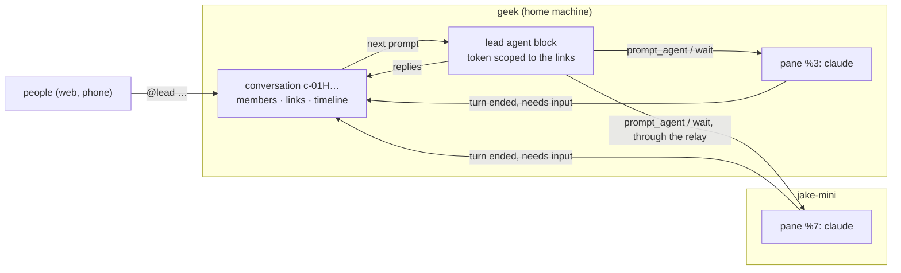

# S36: conversations that link panes across machines, driven by a lead agent (#852)

Part of the CONVERSATIONS tracker (#851). Planned against `main` at 0.38.1 (a8043362). This file is
the brief for now. The spike replaces it with its findings.

## The problem

Chat is threads tied to one pane or one session (M61). `ThreadTarget` is `Pane(id) | Session(id)`.
The machine that runs the pane keeps the thread in `<state>/threads/`, with the pane's access rules.
The Chat page (M73–M75) gathers those threads, but it has nothing of its own. So:

- **A conversation about panes on two machines has nowhere to live.**
- **Nobody in the conversation can drive.** `@agent` reaches only the agent in that pane
  (`tell_agent`, `crates/daemon/src/ops/threads.rs`), and in a session thread it reaches no one.
  The tools that drive (`start_agent`, `prompt_agent`, `wait`, `delegate`) belong to an agent sitting
  in some pane.
- **There's no membership of its own.** Access is copied from one pane.

People already hold conversations like this: a person talks to Claude in a terminal, and Claude
drives other panes through Arugula's MCP. Chat never sees it.

## The shape

- **A conversation is the main object.** It has a global id, a home machine, members (people and
  its lead), **links** (panes, sessions, PRs and issues on any machine) and a timeline. A pane or
  session thread is a conversation with one link, made on first use. The `ThreadTarget` API finds it
  by link, so today's threads keep working.
- **One lead agent per conversation.** It's an agent block on the home machine, and its MCP token
  covers the conversation's links only. That extends the tab scope block tokens already have.
  `@lead` is its next prompt, and its replies are messages. It can start sub-agents, and each one
  becomes a link.
- **Linked panes post events into the timeline:** a turn ended (with a summary), needs input,
  exited, PR checks done. Questions and permission prompts show up as cards that anyone allowed can
  answer in the conversation.
- **It's stored on the home machine, not in control.** The lead runs there, and nothing can be
  driven while it's offline anyway. Control still reads nothing, and M62's MLS team channels (#241)
  stay closed.
- **Access is layered.** Being a member lets you see the conversation. A linked pane's screen and
  quotes are shown only to people that pane is shared with; others see a placeholder. You can only
  link a pane you may drive.

## Decided (Jake, 2026-10-13)

- **The lead acts with the conversation owner's rights.** So membership is a drive grant on every
  linked pane through `@lead`: the invite and the members list say so.
- **One lead per conversation.** It can start sub-agents. The agents in linked panes aren't
  addressed directly from the conversation.
- **The Chat sidebar keeps both.** Conversations go in the *Channels* slot M73 left above the
  machines, and pane threads stay under each machine.

## Questions

1. **Identity and storage.** The id, the file layout next to `<state>/threads/`, and how a thread
   becomes a one-link conversation without breaking `read_thread`/`post_thread`, search, unread
   counts or the "from now" cut-off.
2. **Links across machines.** Same account and a teammate's machine. What a link stores and what
   happens when the pane closes. M77's daemon-to-daemon relay answers only `/api/a2a/`: does it carry
   the mux tools, or does a remote link go through A2A tasks (M78)?
3. **The lead's scope.** A `TokenScope` for "this conversation's links", which tools it gets, and
   how `start_agent` adds a link.
4. **Owner's rights, made safe.** What the invite says. Whether a member who can't see a linked
   pane gets the lead's summaries of it, and the rule.
5. **Events into the timeline.** Which signals exist, how remote ones reach the home machine,
   deduplicated and throttled, and whether cards are answered in place through `act`.
6. **The lead's context.** What it's given each turn, how it survives a daemon restart, and how a
   long conversation is handled.
7. **The Chat page.** *Channels*, creating a conversation, *Add to conversation…* on a pane, and a
   header that shows links.
8. **Phone and push.** `@name` and the lead's answers notify like thread messages do.

**Done when:** this README answers each question. A prototype on geek and jake-mini: a conversation
on geek links a Claude Code pane on each machine, and `@lead` prompts both and waits. Their
turn-ended events appear in the conversation, and a permission prompt from the jake-mini pane is
answered in it. The README recommends milestones from M81 on for #851.
