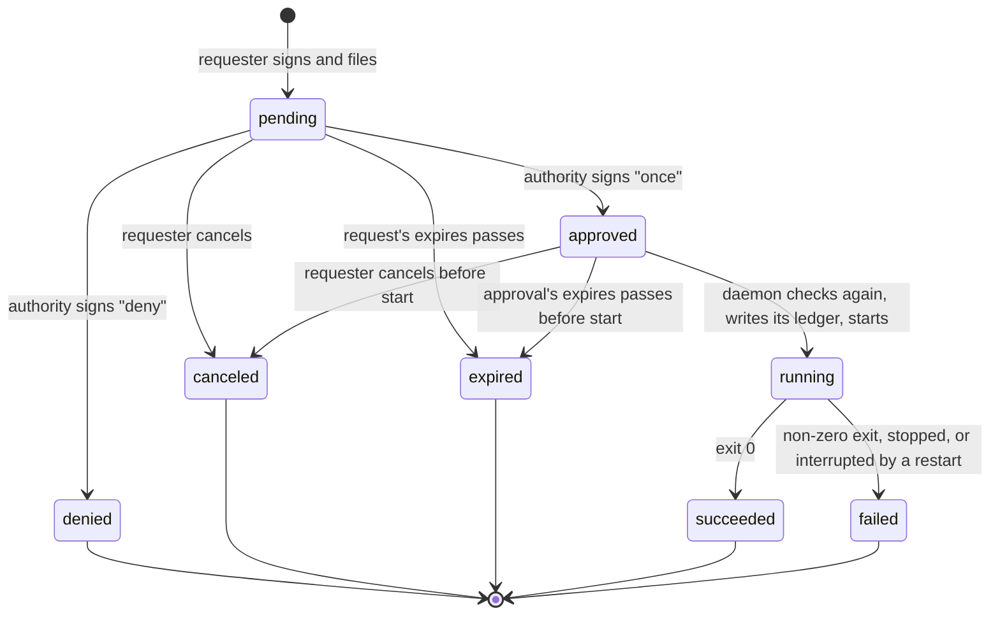

# S37: teams as shared workspaces, with explicit machine and agent execution permissions (#967)

Written 2026-10-17 against `main` at 0.41.0 (aa932b02). Issue #967; tracker #959.

**Result: a design, on paper.** There's no prototype and no rig: the open questions are about
authority, and they're answered by reading the code, not by running it. The milestones (M86–M92,
#968–#974) build it in the order #959 asks for: stages 1–3 first, with the first release after
stage 3.

The one invariant, from #959: **sharing work never silently grants more execution authority.**

What the code does today, in short:
- **Roles stand in for authority.** `Role {Viewer, Editor, Owner}` (`crates/core/src/access.rs:16`)
  says what someone may do in a session. An Editor may type, prompt an agent, approve its tools,
  close panes, and start panes in a VM, all from one role.
- **The checks are spread out.** There's no central policy function. About 150 call sites
  decide, in five places:
  - `crates/daemon/src/authz.rs`: an HTTP path table, with about 56 owner-only routes;
  - `crates/core/src/access.rs` `need()`: WebSocket intents;
  - `crates/mux/src/mux/who_may.rs`: `cant`, `may_drive_here`, `readable`;
  - routes in `crates/daemon/src/api.rs` that check for themselves (`act`, `open_block`, `foreign`);
  - MCP's own `Scope` (`crates/daemon/src/mcp/mod.rs:103`), where a full-scope token is the owner.
- **Teammates are near.** Control's `Relations::of` (`crates/control/src/teams.rs:851`) puts
  every teammate of a machine's owner in `near`. So control routes them to every personal machine
  the owner has, as soon as the daemon names them, with no offer to accept.
- **Trust lives in memory.** Temporary trust (`who_may.rs:275-316`) is a `HashMap`, and a restart
  drops it.
- **Nothing stores a request.** No durable request exists for work on a machine. The nearest
  thing is the A2A tasks (`crates/daemon/src/labs/agents/tasks.rs`): consent cards, *Allow once*,
  *Allow for an hour*, *Deny*, and grants in `a2a/grants.json`, all on the machine that runs them.

Today's Editor trust bypasses are being closed now, in a separate PR that's in flight:
`pane.prompt`, `pane.cd`, card approvals, agent-block calls through `may_drive_here`, `@agent` and
`@lead`. This design takes that PR as done before stage 1. The table in q1 marks those rows "in
flight".

Related, not merged: the `design/control-collab` branch (`docs/control-collab.md`, 2026-10-15)
proposes control as the hub for chat and tasks. Its D1(a) (end to end encrypted in control) and
D4 (a task's state kept in control) agree with q3 and q4 here. Nothing below depends on it.

## Decided before the spike (Jake, 2026-10-17)

These are recorded, not reopened.

1. **Default reach: a breaking change.** Personal machines go private on upgrade, the release
   notes say so, and the owner grants access again. `Relations::of` stops treating every teammate
   as near.
2. **Requests are kept by control.** Control stores and relays durable work requests, so they
   outlive the workstation being offline. Each approval is signed by the owner's device and bound
   to a hash of the exact operation. The daemon checks the signature and the grant again before
   running, and dispatches at most once. **Control never decides.**
3. **Revocation** cuts input and new actions at once. The running process keeps going. *Also stop
   it* is a separate action.
4. **Editor** stays, with Viewer and Owner, as a preset over capabilities. An Editor may view,
   discuss, and drive terminals (behind temporary trust on the owner's machine). Instructing
   agents and approving their tools are the machine owner's, unless granted.

## Answers

1. **Capabilities.** There are thirteen: `view`, `discuss`, `request`, `arrange`, `drive`,
   `instruct`, `approve`, `start`, `sandbox`, `credentials`, `share`, `grant` and `admin`. Each
   entry point maps to one (the table in q1). Viewer, Editor and Owner are presets over them.
2. **One function.** `may(principal, capability, resource)` lives in the mux
   (`crates/mux/src/policy.rs`). Every edge calls it. Operations declare a capability where they
   declare a `Role` today.
3. **Signed objects.** Six line formats, each with its own first line, kept separate from rosters
   and pinned in `frozen.rs`: a work request, an operation, an approval, a standing grant, a
   revocation and a stop. The approval signs the operation's SHA-256 and the request's id.
4. **The lifecycle.** Eight states, three of them dead ends that never run. The daemon keeps a
   ledger written before dispatch, so an id runs at most once.
5. **Mixed versions.** Control applies the new routing to every daemon, old ones included. New
   objects go only to daemons that advertise a feature string. An old client meets a new daemon
   that refuses. Nothing old widens access.
6. **Migration** maps each kind of existing grant to capabilities. What doesn't map cleanly isn't
   carried over: the owner grants it again, and the release notes say so.
7. **Open questions:**
   - **First scopes:** five grants a person can understand.
   - **Delegation:** every principal in the chain must hold the capability.
   - **Discussion and agent input:** an `@agent` from someone who may not instruct becomes a
     proposal, never input.

## q1: capabilities, and what each entry point needs

### The capabilities

| Capability | What it allows | Execution? |
|---|---|---|
| `view` | See a pane, block or session: screen, scrollback and history within the share's floor ("from now"), its thread, its attention | no |
| `discuss` | Post in a pane's or session's thread, react, join its huddle, and propose work (q7c) | no |
| `request` | File a work request against a resource: a machine, an offered agent, a cloud agent. `discuss` on a session includes `request` for that session | no: a request runs only when approved or granted |
| `arrange` | Change the layout without starting or ending a process: resize, move and dock panes and tabs, rename a tab, set options on a tab or pane | no |
| `drive` | Type, send keys, mouse, paste, upload into, `cd` in, close, or take control of an existing pane; set its restart policy and attention | yes: input to a shell is code execution as the machine's user |
| `instruct` | Give an agent work: prompt it, send it a follow-up, `@agent` in its thread, `@lead`, a block call that prompts | yes, through the agent's own tools |
| `approve` | Answer an agent's permission prompt, question or card: `permit`, `act`, a block's `approve` or `answer`, A2A consent | yes: that's what lets the tool run |
| `start` | New processes on the machine itself: a new tab or split there, `/api/run`, a new agent block there, *Run here* | yes, **broad access**: a chosen directory is not a sandbox |
| `sandbox` | New panes or agents in a guest VM on this machine (today's guest path, `guest_intent`) | yes, inside the VM, at the owner's cost |
| `credentials` | Act with the machine owner's logins: forge writes (comment, review, merge), studio, the agents block's `run_there` | yes, as the owner elsewhere |
| `share` | Rename or close a session, share it, make a pane private, purge its history | no, but it decides who sees what |
| `grant` | Issue and revoke grants and trust on this resource | indirectly: it hands out the rest |
| `admin` | Everything that reaches the machine itself: files, hosts, setup, tokens, flags, rules, agent approvals, sandboxes, synced history, offers | yes |

**Resources** are `machine`, `session:ID`, `pane:ID` (with its epoch; a pane inherits its
session's grants), `agent:NAME` (an offered recipe), `conv:ID`, and from M92 `cloud-agent:ID`.

**Principals** are:
- the machine's owner: this account's devices, the Unix socket, a full MCP token;
- a person, `account:ID`;
- a team, `team:ID`;
- an agent acting for a person (`agent:ACCOUNT/NAME`, or a block token, `block:ID`);
- a daemon, `daemon:DEVICE`, which reaches only what a grant names (A2A, links).

**The presets:**

| Preset | Capabilities |
|---|---|
| Viewer | `view` |
| Editor | `view`, `discuss` (with `request` on that session), `arrange`, `drive`. On the owner's own machine, `drive` also needs a trust grant (q7a) |
| Owner of a session | Editor's, and `share` |
| Owner of the machine | all of them |

`instruct`, `approve`, `start`, `sandbox`, `credentials` and `grant` come only from owning the
machine or from a grant (decision 4). Today an Editor has `instruct`, `approve` and `sandbox`, and
`credentials` for forge writes. That's the breaking part of M86, and q6 says what the release
notes tell people.

**A team's machine** (one that joined a team, M19) delegates administration to the team. Its
policy is explicit, in `<state>/policy.json` (`delegated: team`). By default it maps today's
behaviour exactly:
- team owners are the machine's owners;
- team editors get Editor plus `drive` without trust, `instruct`, `approve` and `sandbox`.

That's #959's "deliberately shared team machine". On a personal machine a team role never adds a
capability: it can only lower one (q7a).

### Every entry point, mapped

"Today" is the check as of aa932b02. A row marked *in flight* is closed by the PR that's in
flight; the capability column is the target either way.

**HTTP: operations** (declared in `crates/proto/src/op.rs`, listed with their access in
`crates/daemon/tests/fixtures/ops-access.txt`, handled in `crates/daemon/src/ops/`):

| Operation(s) | Today | Capability |
|---|---|---|
| `pane.capture`, `tail`, `wait`, `export.cast`, `diff`, `process`, `detection`; `GET /api/blocks/{id}` | `Pane(Viewer)`, `from_now` floor (`authz.rs:143`) | `view` |
| `thread.get`, `thread.read` | `Handler`: `thread_role` (`crates/mux/src/mux/thread_ops.rs:45`) | `view` |
| `thread.post` | `Handler`: `role < Editor` refused (`thread_ops.rs:134`) | `discuss` |
| `thread.post` with `@agent` | `may_drive_here` (`thread_ops.rs:173`), *in flight* | `instruct` on the pane, else a proposal (q7c) |
| `conv.*` `@lead` | being a member (`calls_lead`, `thread_ops.rs`) | `instruct` on the conversation, which membership grants explicitly (q7c) |
| `pane.send`, `keys`, `mouse`; `upload`, `paste` (hand-written) | `Pane(Editor)` + `DRIVES` → `Api::MayDrive` (`authz.rs`, `ops/mod.rs:354`) | `drive` |
| `pane.cd` | `Pane(Editor)`, `drives=false`, *in flight* | `drive` |
| `pane.close` | `Pane(Editor)` | `drive` (closing ends the process) |
| `pane.attention`, `pane.ask`, `ask_withdraw`, `pane.hook` | `Pane(Editor)` | `drive`: these are the pane's own program speaking, normally over the socket as the owner |
| `pane.prompt` | `Pane(Editor)`, `drives=false`, *in flight* | `instruct` |
| `pane.followup`, `pane.inbox` | `Pane(Editor)` (`followup` drives) | `instruct` |
| `pane.permit` | `Pane(Editor)`, *in flight* | `approve` |
| `conv.act`, `/api/attention/act` (hand-written) | `Handler`: `act` (`crates/daemon/src/api.rs:252`), *in flight* | `approve`, per pane acted on |
| `pane.drivers`, `pane.ports`, `panes.list` | `Owner` | `admin` (`view` for `drivers` on a viewed pane is a later nicety) |
| `conv.grant` | `Pane(Editor)` + drives | `grant` of the capabilities the maker holds, capped (q6) |
| `conv.grant_revoke` | `Pane(Editor)` | the grant's maker, or `grant` on the pane |
| `conv.create`, `member_add`/`remove`, `rename`, `delete`, `link`, `unlink`, `lead` | `Owner` / `Handler` | the conversation's owner (`share` on `conv:ID`) |
| `acl.*`, `share.*`, `guest.*`, `link.mint`, `invite.send`, `team_pins.*` | `Owner` | `share` (for a session) or `grant` (for a machine) |
| `fs.*`, `host*`, `setup.*`, `mcp_token*`, `flag*`, `rules*`, `agent_approvals*`, `adapter*`, `ide.*`, `sandbox*`, `synced.*`, `studio.*`, `shell_env.*`, `machine.*`, `agents.*`, `fountain.*`, `conversations.*`, `signin_link.get` | `Owner` | `admin` |
| `host.get`, `push.key` | `Anyone` | none |
| `push.subscribe`, `push.test`, `notify.*`, `ide.mention` | `Handler` | none: the caller's own subscription; the handler keeps its checks |

**HTTP: hand-written routes** (`authz.rs:47` `policy`, `ops/mod.rs:430` `HAND_WRITTEN`):

| Route | Today | Capability |
|---|---|---|
| `POST /api/blocks` (`open_block`, `api.rs:775`) | `Handler`: a guest's agent goes on a VM (M14) | `start` on the machine, or `sandbox` |
| `POST /api/blocks/{id}/call/{method}`, default arm | `Pane(Editor)` | decided per method, as below |
| `call/send`, `keys`, `mouse`, `upload`, `paste` | `Pane(Editor)` + `DRIVES_HAND_WRITTEN` | `drive` |
| `call/followup`, an agent block's prompt | `Pane(Editor)`, *in flight* | `instruct` |
| `call/approve`, `answer`, `expire`, `why` | `Pane(Editor)`, *in flight* | `approve` (`why`: `view`) |
| `call/comment` and the forge writes (review, merge) | `Pane(Editor)` (M36) | `credentials` |
| `call/login`, `diff`, `checkout`, `agent`, `live`, `enter`, `profile`, `specs`, `run`, `run_fountain`, `spec`, `run_here`, `run_there`, `open_conversation`, `mark_read`, `answer_request`, `offer`, `unoffer`, `recipes`, `fountain_*`, `principals`, `graph`, `hud` | `Owner` | `admin`; `run_here` and `run` are `start`; `run_there` is `credentials` |
| `/api/run` | `Owner` | `start` |
| `/api/history`, `/api/search` | `Owner` | `admin` (history across panes) |
| `/api/panes/{id}/share-machine` | `Owner` (default arm) | `admin` |
| `/api/sessions/{id}/secrets` | `Owner` | `admin` |
| `/api/a2a/agents/...` | `Handler` (`tasks.rs`) | `request` on `agent:NAME` |
| `/api/a2a/tasks/{id}/consent` | `Owner` + the account check (`api.rs:495` `foreign`) | `approve`, this machine's own account only (M79) |
| `/api/a2a/offers`, `recipes`, `catalog`, `waiting`, `grants`, `delegate`, `run`, `fountain/...` | `Owner` | `admin` (`grants`: `grant`) |
| `/api/threads/...`, `/api/attention` (GET) | `Handler` | `view` / `discuss` as above |
| `/api/turn` | `Anyone` | `discuss` (a huddle's TURN credentials) |
| `/api/editors`, `/api/editors/connect` | `Handler` / socket | `view` (presence), `discuss` (mentions) |
| `/api/sync/*`, `/api/hosts/join` | a host's token (`server::guard`) | none: machine-to-machine, unchanged |
| `/api/daemon/stop` | the socket only | `admin` |

**WebSocket** (`crates/mux/src/mux/clients.rs`, checked per message):

| Message | Today | Capability |
|---|---|---|
| `Attach`, `View`, `Ack`, `Follow`, `Subscribe`, `Focus` | `readable`/`sees` (`who_may.rs:318`) | `view` |
| `Intent::NewSession` | `access::need` → owner (`clients.rs:91`) | `start` on the machine |
| `Intent::NewTab`, `Split` on this machine | `need` → Editor, then `guest_intent` puts a guest's on a VM (`clients.rs:724`) | `start`, else `sandbox` |
| `Intent::RenameSession`, `CloseSession` | `need` → session Owner | `share` |
| `Intent::ClosePane`, `CloseTab` | `need` → Editor; an invite is the owner's (#234) | `drive` on every pane closed |
| `Intent::MovePane`, `MoveTab`, `BreakPane`, `DockTab`, `ResizeSplit`, `RenameTab`, `SetOption` (tab, pane, session) | `need` → Editor | `arrange` |
| `Intent::SetOption` (global) | `need` → owner | `admin` |
| `Cmd::Input` (typing) | `cant(Editor)` + `may_drive_here` (`crates/mux/src/mux/mod.rs:1388`) | `drive` |
| `Pane{TakeControl, RequestControl, GiveControl, ReleaseControl, SetPair}` | `cant(Editor)` (`clients.rs:181`, `who_may.rs:164`) | `drive` |
| `Pane{RequestTrust}` | `cant(Editor)` | `discuss` (asking is talking) |
| `Pane{GrantTrust, RevokeTrust}` | owner only (`who_may.rs:239`) | `grant` |
| `Pane{SetPrivate}` | owner only (`who_may.rs:250`) | `share` |
| `Pane{Purge}` | `cant(Editor)` (`clients.rs:214`): an Editor can purge history today | `share` |
| `Pane{SetPolicy, SetIntegration, Attention}` | `cant(Editor)` | `drive` |
| `CallJoin`, `CallLeave`, `CallMute`, `CallSignal` | the session's role (`call_ops.rs`) | `discuss` |

**MCP** (`crates/daemon/src/mcp/mod.rs`, `tools.rs`):

| Caller | Today | Becomes |
|---|---|---|
| no bearer, or the daemon's local token | `Scope::Full`: the owner | the owner |
| a client token, full | `Scope::Full`: the owner | the owner: a token the owner minted is theirs (q6) |
| a client token, read | `Scope::Read`: the GETs not marked `CREDENTIAL` | `view` and the read-only `admin` reads, as `ops-read-only.txt` lists them |
| an agent block's token | `Scope::Block`: its own tab; drives what it started (`tools.rs:2178` `drivable`) | `block:ID`, acting for whoever it's working for (q7b): `run`/`start_agent` need `start` (or `sandbox` in a VM tab), `send_input` needs `drive`, `prompt_agent` needs `instruct`, `agent_respond` needs `approve`, `post_thread` needs `discuss`, `invite_person` needs `share`, `delegate` needs `request` on the far agent |
| a conversation's lead | `Scope::Lead`: links by name, the grant maker's rights capped at Editor | the same, capped at what the link grant carries (q6) |

**Peer and tunnel paths:**

| Path | Today | Becomes |
|---|---|---|
| A device's channel through control (`crates/daemon/src/e2e.rs`) | the device's cert → a principal (`Enrolled::build`, `crates/daemon/src/control.rs:254`); then the HTTP and WebSocket rows | unchanged; the rows apply |
| A daemon's channel (`serve_agent_caller`, `e2e.rs:303`) | `/api/a2a/` only (`agents_only`, `e2e.rs:292`), plus a granted link's prompt, wait, capture, events and act | `request` on the agent; a link's grant names its capabilities |
| A host pushing to its synced copy (`/api/sync/*`) | the host's token | unchanged |
| A remote block (#17) | the far daemon checks | unchanged: the far daemon runs `may` |
| A guest over ssh (M65, `crates/daemon/src/labs/guest_ssh.rs`) | an owner-minted guest | `drive` on that pane, or `sandbox` |
| A read-only link (M19, `acl.rs` `link_by_key`) | a key and an expiry | `view` |
| The tmux `-CC` front end | the socket: the owner | the owner |

**CLI** (`crates/cli`): on the Unix socket (`localauth.rs`) or as a device of the machine's own
account, it's the owner. A teammate's CLI reaching a machine through control is a device of their
account, so the HTTP rows apply. `arugula hook`, `ask` and `attention` run inside a pane over its
socket, as the owner, and stay so. There are no CLI-only checks to move.

## q2: one function

```rust
// crates/mux/src/policy.rs
pub fn may(&self, who: &Principal, cap: Cap, on: Resource) -> Result<(), Refusal>;
```

- **What it reads:** `acl.json` grants (as capability sets), the machine's policy (personal, or
  delegated to its team), standing grants and trust (M88), the conversation records, and the team
  roles the daemon verified. Nothing comes from control at decision time.
- **Where it lives:** in the mux, because the mux owns the layout that resources resolve against
  (a pane's session, a tab's machine), and `who_may.rs` is already there. `core::access::need`
  stays pure: it returns `(Cap, Vec<Resource>)` for an intent instead of a `Need { role }`.
- **`Refusal`** names the capability and what would get it: "you may watch %3 but not type in it:
  ask Jake to trust you with it", or "instructing this agent is Jake's: propose it instead". The
  web client shows the `ask` it carries as a button (*Ask to drive*, *Propose*, *Request a run*).
  It's one place for every edge's wording, where `cant` and `may_drive_here` each word it today.
- **The edges:**
  - **`proto::op::Access`** gains `Cap(Cap)` beside `Owner`, `Handler` and `Anyone`. A declared
    `Pane(Role)` becomes `Cap`, and `DRIVES` folds into the capability (`drive`). `authz::check`
    calls `may` once.
  - **The hand-written path table** in `authz.rs` gets a `Cap` per arm. `ops-access.txt` names it.
  - **WebSocket:** `clients.rs` calls `may` for intents, pane ops and input. `cant` and
    `may_drive_here` go.
  - **MCP:** a `Scope` becomes a principal (block, lead or owner). Each tool declares its
    capability as each operation does. `readable` and `drivable` call `may`.
  - **`api.rs`'s own checks** (`act`, `open_block`, `foreign`, `is_invite`, `is_agents`) become
    `may` calls with the right resource. The account check (M79) is a `Resource::Machine` rule:
    "this machine's own account only".
- **Two checked-in fixtures**, as today:
  - `ops-access.txt` (each operation's capability);
  - a new `ops-presets.txt`: each preset against each operation, on a personal machine and on a
    team machine.

  A change shows in review.
- **What M86 can't use:** the role-ordering trick (`r >= Role::Editor`). Capabilities are a set,
  not a ladder: `share` without `drive` is a real combination.

## q3: signed objects

**Why they're separate from rosters.** `Roster::well_formed()` (`crates/e2e/src/team.rs:352`)
takes versions 1 and 2 only. A daemon that meets a roster it can't verify freezes membership at the
last one it could. A grant in the roster would freeze every old daemon's team. So grants,
requests and approvals are their own objects. Each is a fixed line format, so WebCrypto and Rust
sign the same bytes, in the style of `Move`, `AskInvite` and the block grant (`arugula block grant
v1`, `crates/e2e/src/block.rs:13`). Each first line is its domain separator, pinned as hex in
`crates/e2e/src/frozen.rs`. They're born after the rename, so they say "arugula".

**Values.** A value that can hold anything (a command, a prompt, a path) is base64 (standard,
padded), so no value holds a newline. Ids are 32 hex digits from 16 random bytes. Times are ms
since the epoch. `-` means none. Lines come in the order shown, and lines that repeat are sorted.

### The operation

The thing being approved. Its SHA-256 over these exact bytes is the **operation hash**.

```text
arugula op v1
daemon <the target daemon's device id>
kind <run|shell|instruct|agent>
session <id|->
pane <id|-> <epoch|->
cwd <base64|->
argv <base64>            (once per argument, in order; kind run)
text <base64|->          (the instruction; kind instruct, agent)
agent <recipe name|->    (kind agent)
env <NAME>               (once per variable passed, sorted; names only, values are the machine's)
```

- `run` is one command in a new pane, which ends when the command does.
- `shell` is a new interactive shell. It's always "broad access".
- `instruct` is a prompt to an existing agent pane.
- `agent` is a new agent block from a recipe.

Changing any byte (another directory, another argument, the same command on another machine)
changes the hash, so it needs a new approval (#959: "changed operations require new approval").

### The request

Signed by the requester's device. Control stores it, and can't forge one.

```text
arugula work request v1
id <32 hex>
daemon <target device id>
from <account id of the person who asked>
via <agent principal>    (once per hop, in order from the person; none for a person asking directly)
op <operation hash, hex>
made <ms>
expires <ms>
by <requester's device id>
```

### The approval

Signed by a device of the resource's authority: the machine's own account, or on a team machine a
team owner in a roster the daemon verified.

```text
arugula work approval v1
request <id>
daemon <device id>
op <operation hash, hex>
from <the request's from>
decision <once|deny>
expires <ms: by when it must start>
by <approver's device id>
```

It names the request's id **and** the operation's hash. So an approval can't move to another
request, and the same operation asked again is a new id that needs a new approval. A deny is signed
too, so the record says who denied it. Control could forge a deny, but that's refusing service,
which control can always do.

### The standing grant

```text
arugula exec grant v1
id <32 hex>
daemon <device id>
resource <machine|session <id>|pane <id> <epoch>|agent <name>|conv <id>>
to <account:<id>|agent:<account>/<name>|team:<id>>
caps <capability>        (once per capability, sorted)
made <ms>
expires <ms|never>
by <device id>
```

A grant made on the machine itself (its own page, the socket) is stored the same way with `by
local`, and doesn't need a signature. On a personal machine, a grant to `team:` may carry `view`,
`discuss` and `request` only (q7a).

### Revoking, and stopping

```text
arugula exec revoke v1
grant <id>
daemon <device id>
at <ms>
by <device id>
```

```text
arugula work stop v1
daemon <device id>
target <request <id>|pane <id> <epoch>>
at <ms>
by <device id>
```

They're two objects because decision 3 makes them two actions:
- **A revoke** cuts the grantee's input and new actions on every path at once. It drops them as a
  pane's driver, and a link or delegation made under the grant stops working.
- **A stop** ends a process: SIGTERM to the pane's process group, then SIGKILL after 10 s. The
  owner's page offers it beside *Revoke* as *Also stop it*.

**What control can and can't do with them.** Control relays every object here. Each one is
signed by a device the daemon checks back to a root it already holds. So control can delay or drop
an object, but it can't make or change one. Dropping a revoke is the one that matters: it keeps a
grant working on a machine that hasn't heard. Three things bound it:
- the owner can always revoke on the machine itself (its page, the socket, the desktop app);
- grants made through control default to an expiry (q7a);
- a daemon that's been out of touch with control longer than a grant's own `made`-to-`expires`
  span treats the grant as expired until it reconnects.

**Sealed bodies.** The operation's bytes are input to someone's machine, and
[DECISIONS](../../DECISIONS.md)' "Control can refuse service but can't read" covers input. So
control keeps the request's metadata in the clear: id, daemon, from, via, the operation hash,
times, state. The operation itself is sealed: an X25519 box per recipient, using the Noise keys in
their certificates already. The recipients are the target daemon, the authority's devices (so the
owner's phone can show what it's approving while the workstation is offline) and the requester's
devices. Results are sealed the same way. This costs one new primitive in `crates/e2e`; the
alternative, control reading commands, would weaken a settled decision, which this design doesn't
do.

## q4: the request lifecycle



- **Dead ends.** Denied, canceled and expired are terminal. Nothing leaves them, and none leads
  to a run (#959). A request that's denied and asked again is a new request with a new id.
- **Who moves it:**
  - `pending`, `canceled` (signed by the requester), `approved` and `denied` (signed by the
    authority) are recorded by control as the objects arrive;
  - `running`, `succeeded` and `failed` are reported by the daemon, signed with its key;
  - control applies `expired` by the clock, and the daemon applies it again by its own clock
    before starting.
- **A standing grant skips `approved`.** When the requester holds a grant that covers the
  operation, the daemon may go straight from `pending` to `running`. It records which grant it ran
  under.
- **The second check, at the start.** The daemon checks, in order:
  1. the request's signature, and that `from` is still someone it trusts (a member of a roster it
     verified, or a peer whose root a grant pinned);
  2. the operation's bytes hash to `op`;
  3. the approval's signature, its `op` and `request`, and its expiry; or the grant's capabilities,
     resource, expiry and that it isn't revoked;
  4. every principal in `via` holds the capability, or the approval covers it (q7b);
  5. the target still exists (the session; the pane and its epoch).

  If any check fails, the request is `failed` with the check's name, and it doesn't run.
- **At most once.** The daemon's ledger is `<state>/work/ID.json`. Before it starts a process it
  writes `running` there and fsyncs. Then:
  - an id that's already in the ledger is never started again, whatever control sends (a
    duplicate delivery, a retry, a replayed approval);
  - a daemon that restarts and finds `running` with no live pane for it marks the request `failed`
    ("interrupted by a restart; not run again").

  So a crash can lose a run, but it can never double one. That's the only safe direction.
- **Expiry:**
  - **A request** defaults to 7 days, at most 30.
  - **An approval** defaults to 24 hours, at most 7 days.
  - A workstation that's offline past its approval's expiry comes back to `expired`, and the
    requester asks again.
  - The approver's device sets `expires` by its own clock, with ten minutes' slack. The daemon
    can't be asked, because it may be offline.
- **Results:** the exit status, the duration, and a bounded tail (64 KB) of the run's output,
  sealed to the requester and the session's viewers, posted in the session's thread and kept on the
  request in control. The full transcript stays in the pane on the workstation, for those who may
  view it (#959: no transcript uploaded).
- **Delivery.** A daemon that advertises `work-requests` pulls what's waiting for it when it
  connects. Control nudges it over the relay when something new arrives, as it does for shares
  today (`app.relay.nudge`). Requests and approvals never ride a browser's connection, so closing a
  tab loses nothing.

## q5: mixed versions

Two feature strings join the ones the daemon advertises today (`crates/daemon/src/control.rs:86`,
`presigned-invites,owner-moves,join-secret`). Control checks them as it checks those
(`crates/control/src/teams.rs:60-90`):
- `exec-policy` (M86): this daemon enforces capabilities;
- `exec-grants` (M88) and `work-requests` (M89): this daemon takes signed grants, requests and
  approvals.

| Daemon | Control | Client | What happens |
|---|---|---|---|
| new | new | new | The design. |
| old | new | any | **Routing is private by default anyway:** the new `Relations` applies to every daemon, so implicit teammate reach goes (decision 1). An old daemon still gives Editors today's powers on sessions it explicitly shared. Control lists it as "needs an update" on its page, and queues no requests, grants or approvals for it. The release notes ask people to update. |
| new | old | any | An old control still routes teammates as near, but the new daemon lets in only who its own grants name and decides with `may`, so nothing widens. No requests (old control has no store); the client hides the inbox. |
| new | any | old web client or old desktop app | The old client sends what it always did. The daemon refuses what the person's capabilities don't cover, with the `Refusal`'s sentence, which the old client shows as an error. It fails closed. |
| old | any | new | The client reads the daemon's features (`/api/host`) and falls back to roles: no inbox, no grant UI, and "this machine needs an update to take requests". |
| new | new | old CLI | The owner's CLI is the owner, so nothing changes. A teammate's old CLI is refused as an old web client is. |
| mixed team: some machines new, some old | new | any | Grants aren't in rosters, so no daemon freezes membership. An old team machine keeps today's team roles, which are also the new team-machine default (q1). Nothing changes on it. |
| a conversation's home new, the linked machine old | any | any | The old machine checks its link grants as today (the grant maker's rights, capped at Editor). The link keeps working, with the old powers, until that machine updates. |
| a conversation's home old, the linked machine new | any | any | The new machine checks the link's grant capabilities (q6). A prompt from a link whose maker had no `instruct` is refused, and the old home shows the error. |
| a self-hosted control downgraded after M89 | old | any | Requests waiting in control are invisible until it's upgraded again. Daemons keep their ledgers, so nothing reruns when they come back. |

**The rule that holds across the matrix:** the daemon that owns the resource decides, by its own
grants, and an old component can only refuse or show less. Control's one change of meaning
(routing) narrows what it routes; it never widens it.

## q6: migration (designed inside stages 1 and 2)

| What exists | Where | Becomes | Why |
|---|---|---|---|
| A session share, Viewer | `acl.json` `Grant` (`crates/mux/src/acl.rs:63`) | `view` | maps cleanly |
| A session share, Editor | `acl.json` | the Editor preset: `view`, `discuss`, `arrange`, `drive` behind trust | decision 4. `instruct`, `approve`, `sandbox` and forge `credentials` aren't carried over |
| A session share, Owner | `acl.json` | Editor's preset, and `share` | maps cleanly |
| A "from now" share | `Grant.from` | unchanged: `view` keeps its floor | settled (M13) |
| A share to a team (M30) | `acl.json` `team:ID`, capped by team role (`acl.rs:222`) | the share's preset; the team role can lower it, never raise it | the cap already only lowers. Execution grants to `team:` on a personal machine aren't allowed (q7a) |
| A read-only link | `Grant.key`, `expires` | `view` until it expires | maps cleanly |
| Temporary trust | in memory (`who_may.rs:275`) | a `drive` grant on the pane, with its expiry, on disk (M88) | an upgrade restarts the daemon, which drops today's trust anyway |
| A team machine's roles | the roster (`Enrolled::build`, `control.rs:254-318`) | the default delegated policy (q1), which keeps today's behaviour | #959: "Preserve deliberately shared team machines" |
| A conversation's link grant | `<state>/conv-grants.json` | the capabilities its maker held when it was made, capped at `view`, `instruct`, `approve`. The machine's owner keeps all three. An Editor's link loses `instruct` and `approve`, and the conversation's header says "needs Jake's grant" | the grant maker's rights were the cap, and decision 4 lowers an Editor's |
| Conversation membership | the record's members | unchanged: an explicit `instruct` through `@lead`, which the invite already says | it was made explicit on purpose (#858). The lead reaches a link only within the link's grant |
| A2A *Allow for an hour* | `<state>/a2a/grants.json` | a `request` grant on `agent:NAME` for that account, with its expiry | maps cleanly |
| MCP client tokens | `mcp/tokens.rs` | unchanged: full is the owner, read is `view` | the owner minted them for themselves |
| Control: teammates near | `Relations::of` | gone (M87). Accepted share answers are kept. Team shares route by the `teams` the daemon names | decision 1 |

**Never widened:** each row above keeps or narrows what someone could do before. Where a row
narrows, the owner sees a one-time notice on the machine's page: "Arugula changed what editors can
do on this machine. Sam and Riley could prompt agents in *calc*: grant it again?" Beside it are
*Grant again…* and *Leave it*.

**Release-note text** (M87, for the release that ships M86 and M87):

> **Your machines are private to you by default.** Joining a team no longer makes your personal
> machines reachable by your teammates. People reach a personal machine only where you've shared
> a session with them or with a team, and a session shared with a team stays at the access you
> chose, whatever role the team gives someone.
>
> **Editors view, discuss and drive; agents and new processes are yours.** On a session you share
> as Editor, people can watch, talk in its threads, and type into its terminals once you trust
> them with a pane. Prompting its agents, approving their tools, starting new shells or agents,
> and acting with your forge login now need a grant from you. If people relied on that, the
> machine's page lists what changed and offers to grant it again.
>
> **Team machines are unchanged.** A machine you put in a team still works by the team's roles.
>
> Update every machine: one on an older release keeps the old Editor rules for sessions it shares,
> and control's page marks it "needs an update".

## q7: the open questions #959 leaves

### a. The first grant scopes

**Recommendation: five grants a person can read at a glance.** Everything else is a per-run
approval.

| The grant, as the UI says it | Capabilities | Resource | Default expiry |
|---|---|---|---|
| **Drive this pane** (today's trust) | `drive` | a pane and its epoch | 1 hour (1 minute to 24 hours, as today) |
| **Work with the agents in this session** | `instruct`, `approve` | a session | 8 hours |
| **Request runs on this machine** | `request` on a machine (requests still wait for approval) | a machine | never |
| **Use my agent NAME** | `request` on an offered agent | `agent:NAME` | 1 hour (as *Allow for an hour*), or never |
| **Start shells on this machine: broad access** | `start` | a machine | 1 hour, at most 7 days |

- **The words matter.** *Start shells* always says: "A shell here can do anything you can. A
  directory you pick is where it starts, not a fence." There's no "shell in this directory" scope
  (#959).
- **Grants on a personal machine name people,** not teams, for anything beyond `view`, `discuss`
  and `request`. A team admin can add anyone to a team, so a team-wide execution grant on a
  personal machine would let membership changes grant execution, which #959's second acceptance
  criterion forbids. A team machine has no such limit: it's the team's.
- **Not first:** per-tool approvals (an agent's `Bash` allowed for someone else's prompts), a
  grant per command pattern, and grants on a conversation as a whole. Each can be added as a
  capability on a resource later without changing the formats.

### b. How a delegated agent is held to the requester's authority

**Recommendation: every principal in the chain must hold the capability. An agent's own rights
never stand in.**

- **A request carries its chain** (`from`, then each `via`). The target checks each one, and an
  approval that covers the operation can stand in for the whole chain. So:
  - Sam asks Sam's agent to run tests on Jake's machine. The request is `from sam via
    agent:sam/fixer`. It runs if Sam holds a grant there (and the agent is allowed to act for Sam,
    which is Sam's to say), or if Jake approves this one.
  - Jake's own agent, prompted by Sam, acts for Sam. That means `from sam via block:12`. Not for
    Jake.
- **An agent block acts for whoever gave it the current work.** Its MCP token's principal is the
  block, and `may` checks the block's scope (its tab, what it started) **and** the principal of
  record for the turn:
  - the machine's owner, for the owner's own prompts;
  - the person whose `instruct` started the turn, for anyone else's.

  Every way a turn starts (`pane.prompt`, a follow-up, `@agent`, an A2A task) passes an edge
  that knows its caller, so the block records that principal for the turn. That closes the path where a prompt from someone with `instruct` lets the agent `run` with the
  owner's `start`.
- **A cloud agent (M92)** is `via cloud-agent:ID`, `from` the person who started the run. It
  never has a standing grant on someone's workstation of its own.
- **The A2A consent check by account** (M79) stays as a rule on the machine: only its own account
  answers its task cards.

### c. Discussion apart from agent input, in the protocol

**Recommendation: posting is never input. An `@agent` from someone who may not instruct becomes a
proposal, which someone who may instruct sends or dismisses.**

- **On the wire:**
  - `thread.post` carries discussion only.
  - Input to an agent is its own operation (`pane.prompt`, `pane.followup`, a block's prompt
    call), needing `instruct`.
  - Today `thread.post` turns `@agent` into a follow-up when `may_drive_here` passes
    (`thread_ops.rs:166-173`). Instead it checks `may(who, instruct, pane)`.
    - If it passes, the post is also sent as a follow-up, recorded with the poster as the
      principal of record (q7b).
    - If it fails, the post is marked `ThreadMsg.proposal: {kind: instruct, op}`, with `op` the
      operation hash of the follow-up it would have been.
- **In the UI:**
  - A proposal shows in the thread as a card: "Sam proposes to the agent: …", with *Send to
    agent* and *Dismiss* for whoever holds `instruct`. *Send* sends exactly that text (its hash),
    as the approver.
  - The composer says where a message goes: *Discussion*, or *To the agent* when the person may
    instruct.
- **The same shape works across machines.** A proposal on a pane thread is a local work request of
  kind `instruct`. When the pane's machine is someone else's, *Send to agent* from a person
  without `instruct` there files an M89 request.
- **A conversation's `@lead`** is input to the lead, and membership is the explicit grant for it
  (q6). What the lead can do on a link is the link grant's, so a member can't reach further
  through the lead than the linker allowed.

## The milestones (from M86, for #959)

Each builds on the previous one unless it says otherwise. Migration is designed inside stages 1
and 2 (q6), not as a stage of its own.

**Where this departs from the split in the brief: stage 2 is two milestones, M88 and M89.**
Standing grants, revocation and persisted trust are the daemon's alone. They have no control
schema, no relay messages, and no state machine, and they can ship and be tested with the owner
granting from the machine itself. Durable requests add control's storage, sealed bodies, the
relay, the ledger and the state machine. Splitting them puts revocation (decision 3) in people's
hands one release earlier, and keeps each PR reviewable.

- **M86 (#968): one policy function, and capabilities instead of roles** (stage 1a).
  - `may` in `crates/mux/src/policy.rs`.
  - The thirteen capabilities and three presets.
  - `Access::Cap` in `proto`; `authz.rs`, `who_may.rs`, `api.rs`, `clients.rs` and MCP all
    through `may`.
  - `ops-access.txt` names capabilities, and `ops-presets.txt` is new.
  - The team machine's delegated policy.
  - Feature `exec-policy`.
  - DECISIONS amended ("One function says what an intent needs", "A guest types on your machine
    only by trust, or in a VM", the conversation-membership line). `just proto-ts`.
  - **Done when:**
    - a shared session allows observation and discussion, and no terminal input, agent
      instructions, tool approvals or new processes, unless granted;
    - a team admin can't gain execution rights on a personal machine by changing team roles or
      membership;
    - a deliberately shared team machine runs work by its delegated policy;
    - authorization tests cover HTTP, WebSocket, CLI and MCP, for each preset and capability.
- **M87 (#969): personal machines are private by default** (stage 1b).
  - `Relations::of` without the owner's teammates.
  - A `teams` field in `wire::AccessList`.
  - Old daemons routed by the same rule.
  - Control's page says who can reach each machine and why.
  - The release-note text above.
  - The migration notice on the machine's page.
  - **Done when:**
    - installing Arugula and joining a team leave the workstation and its sessions private, on
      this release's daemon and the last one's;
    - membership changes are tested;
    - mixed-version tests (`ARUGULA_FEATURES=""` playing the last daemon) and migration tests
      pass.
- **M88 (#970): signed standing grants, revocation, and trust that survives a restart** (stage
  2a).
  - `arugula exec grant v1`, `exec revoke v1` and `work stop v1` in `crates/e2e/src/exec.rs`,
    pinned in `frozen.rs`.
  - `<state>/exec/grants.json`.
  - Trust becomes a `drive` grant on disk.
  - Revocation per decision 3, and *Also stop it*.
  - Grants listed on the pane menu, *Share* and the machine's page.
  - q7a's five scopes.
  - A2A and link grants migrated.
  - Feature `exec-grants`.
  - **Done when:**
    - explicit standing grants can be inspected, expired and revoked by the resource's
      authority;
    - revocation is tested on every action path, with the running process left alone unless
      stopped;
    - tests cover expiry, untrusted signers, the wrong daemon, and replay after a revoke.
- **M89 (#971): durable work requests** (stage 2b, after M88).
  - `arugula op v1`, `work request v1` and `work approval v1`.
  - Control's `work_requests` table (`SCHEMA` and `migrate()` in `crates/control/src/db.rs`) and
    `control-wire` messages.
  - Sealed operation bodies and results.
  - The eight states (q4).
  - The daemon's ledger and at-most-once dispatch.
  - The second check at the start.
  - Delegation chains (q7b).
  - Feature `work-requests`.
  - **Done when:**
    - an approved operation can't be changed or replayed into more runs (a changed operation, a
      reused approval, a duplicate delivery and a restart mid-dispatch are each tested);
    - requests outlive disconnection and resume only after the second check;
    - tests cover duplicate dispatch, expiry, offline execution and agent delegation.
- **M90 (#972): the request inbox and the whole personal-workstation flow** (stage 3, after M87
  and M89). **The first release point.**
  - *Request a run…* on a shared session.
  - Proposals from `@agent` (q7c).
  - The inbox on the swarm rail and the phone's *Needs you*, with attention and push.
  - *Approve this request*, *Deny*, *Grant ongoing access…*.
  - The result in the session's thread.
  - The requester's own list.
  - A live run on geek and jake-mini with two accounts, from a browser and the phone.
  - **Done when:**
    - a teammate requests a run on Jake's workstation, Jake approves that one run from his
      phone, the workstation runs it (offline at the request, online later), and the shared
      result appears in the thread;
    - the teammate has no continuing access afterwards: a second identical request waits for
      approval.
- **M91 (#973): the team landing page** (stage 4).
  - A team route on control's page, replacing the Teams modal (`web/src/ui/control.tsx:2230`) as
    the way in.
  - Built on the swarm and attention: shared sessions and activity, shared agents and
    availability, requests waiting, active work and results, and the machines available for
    execution, each with where work runs and who controls it.
  - Personal work stays out until it's shared.
  - Request status comes from control, with no transcript uploaded.
  - **Done when:**
    - the team page centres shared agents, sessions, requests and results, and works with zero
      shared machines;
    - a team machine shows its delegated policy.
- **M92 (#974): shared Managoat agents** (stage 5, after M89 and M91).
  - Definitions, runs and execution identities kept apart in control's cloud records
    (`crates/control/src/cloud/`, `db/cloud.rs`).
  - Definitions a team owns.
  - The requester on every run.
  - Team secrets sealed with `team:ID` as AAD (today it's the account, `cloud/secrets.rs:20`).
  - A funding owner per run.
  - A cloud agent reaching a workstation files a work request `from` the person `via` the agent.
  - **Done when:** shared Managoat agents keep the requester's identity and enforce resource
    grants without accidentally inheriting anyone's personal authority.

**#959's acceptance criteria, by milestone:**

| Criterion | Milestone |
|---|---|
| Installing and joining a team leave the workstation private | M87 |
| A team admin can't gain personal-machine execution by changing roles | M86 |
| A shared session allows observation and discussion only | M86 |
| A one-run approval, with a shared result and no continuing access | M90 |
| An approved operation can't be changed or replayed | M89 |
| Standing grants can be inspected, expired and revoked | M88 |
| A shared team machine runs work by its delegated policy | M86 (built), M91 (shown) |
| Shared Managoat agents keep requester identity | M92 |
| Requests survive disconnection and resume only after a second check | M89 |
| Revocation and membership changes are tested on every path | M87 (membership), M88 (revocation) |
| Authorization tests cover HTTP, WebSocket, CLI/MCP, delegation, duplicate dispatch, expiry, offline, migration | M86 (paths), M87 (migration), M88 (expiry), M89 (delegation, duplicates, offline) |
| Team navigation centres shared work, with zero machines | M91 |

## For Jake

These need a yes or a different answer. Each comes with the design's recommendation.

1. **"Private on upgrade": a reading.** The design takes decision 1 to mean that implicit reach
   goes (teammates near), and that execution powers an Editor no longer has (instruct, approve,
   start, forge writes) aren't carried over. Explicit session shares keep their view, discuss and
   drive (q6), as #959's migration section asks. The other reading is stricter: every personal
   share is dropped, and owners share again from scratch. Recommended: the first.
2. **Sealed operations in control** (q3) add one primitive to `crates/e2e`, an X25519 box per
   recipient. The alternative is that control reads the command lines it stores. Recommended:
   sealed, which keeps "Control can refuse service but can't read" true.
3. **Forge writes leave the Editor preset** (`credentials`). Today an Editor can comment, review
   and merge with the owner's login (M36). Recommended: they leave it, as acting with the owner's
   identity elsewhere.
4. **The conversation lead** keeps "membership is an explicit instruct grant through @lead"
   (#858). What the lead can do on a link becomes the link grant's capabilities, so an Editor's
   link loses `instruct` and `approve` (q6). Recommended: yes. The alternative is to carry links
   over unchanged and accept the gap until they're made again.
