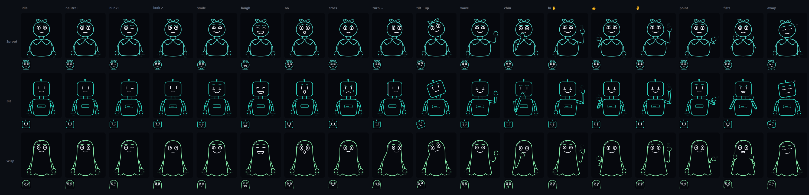
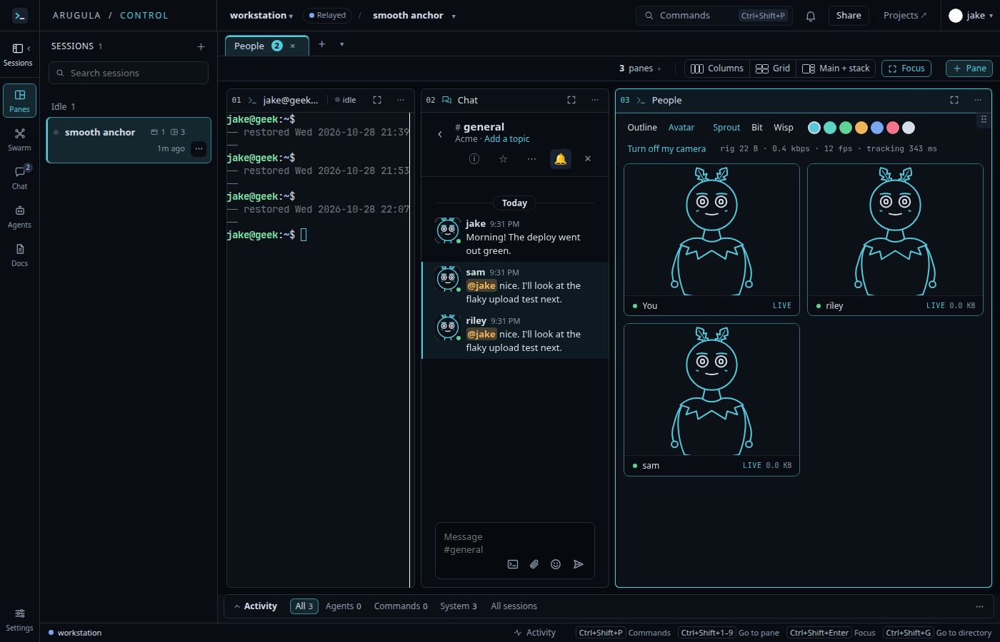

# S44: rigged avatars, your camera drives a 2D character (Arugula #312)

Built 2026-10-28 on branch `s44-rig-avatars`, on top of S43 (`s43-outline-presence`, #310), feeding
#311. Pitch: arugula Doc d85259ed5ef351fd on geek. Jake's calls: 2D characters first, bust tracking,
avatars beside outlines as a mode, Codex drafts the characters and Claude tunes them.

**What it does:** in the People block, *Avatar* instead of *Outline*, a character (Sprout, Bit,
Wisp) and a colour. With the camera on, the page tracks your face and upper body and sends only a
rig, 22 bytes a frame (more with arms in view) at 12 fps, about 0.5 kbps. Every page draws your
character from it, eased to the screen's rate, in the People tiles and live in chat avatars. With
the camera off, an avatar idles (breathes, blinks, glances about) and dozes while you're away.
No picture of you leaves the page.

| Piece | Where |
|---|---|
| Rig: fields, bust space, wire format (kind 0x40 inside S43's frames), idle, easing | `web/src/shared/avatar/rig.ts` |
| Solver: head angles from the face transform, ARKit blendshapes to the rig, pose to arms; One-Euro smoothing | `web/src/shared/avatar/solve.ts` |
| Trackers: MediaPipe face landmarker (blendshapes + transform) and pose landmarker lite | `web/src/shared/avatar/track.ts`, `cam.ts` |
| Characters: Codex drafts to `character.ts`'s contract, then a final-art pass (Codex at high effort, briefed with the contact sheet and a style bar), proportions and hand size tuned | `web/src/shared/avatar/characters/` |
| Hands: the hand landmarker (21 points a hand) → which way each points and each finger's curl, 6 bytes a hand; given to the nearer pose wrist, and standing in for a wrist the pose lost; drawn by a shared cartoon hand | `solve.ts` (`handOf`), `web/src/shared/avatar/hand.ts` |
| Stage: bust space on a canvas, the head-only crop, one animation loop for every avatar | `web/src/shared/avatar/stage.ts`, `view.tsx` |
| Contact sheet, for tuning characters by eye (`pnpm exec vite`, /avatar-sheet.html) | `web/avatar-sheet.html`, `web/src/shared/avatar/sheet.ts` |

The relay is S43's, unchanged: a rig is opaque bytes to control, and dev-control's echo (sam and
riley) re-posts it. `web/scripts/outline-assets.sh` also fetches the pose model (5.8 MB).

**Measured:** a rig is 22 bytes without arms, about 30 with them; 0.4–0.6 kbps at 12 fps.
Tracking took 200–340 ms a frame in headless Chrome without a GPU (so it ran slower than 12 fps
there); on jake-air's GPU it's unmeasured. The fake camera has no face, so whether the head angles'
signs, the blink thresholds and the arm mapping feel right is Jake's first test.

**Not done:** the choice is per browser (localStorage), not kept in control, so someone you've
never seen send a rig shows their picture until they do; a Labs flag. Hands and the final art
pass landed after the first commit (models: +7.8 MB for hands).
